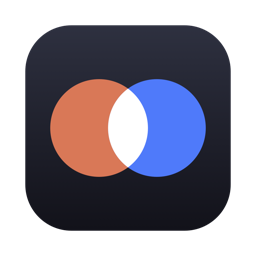
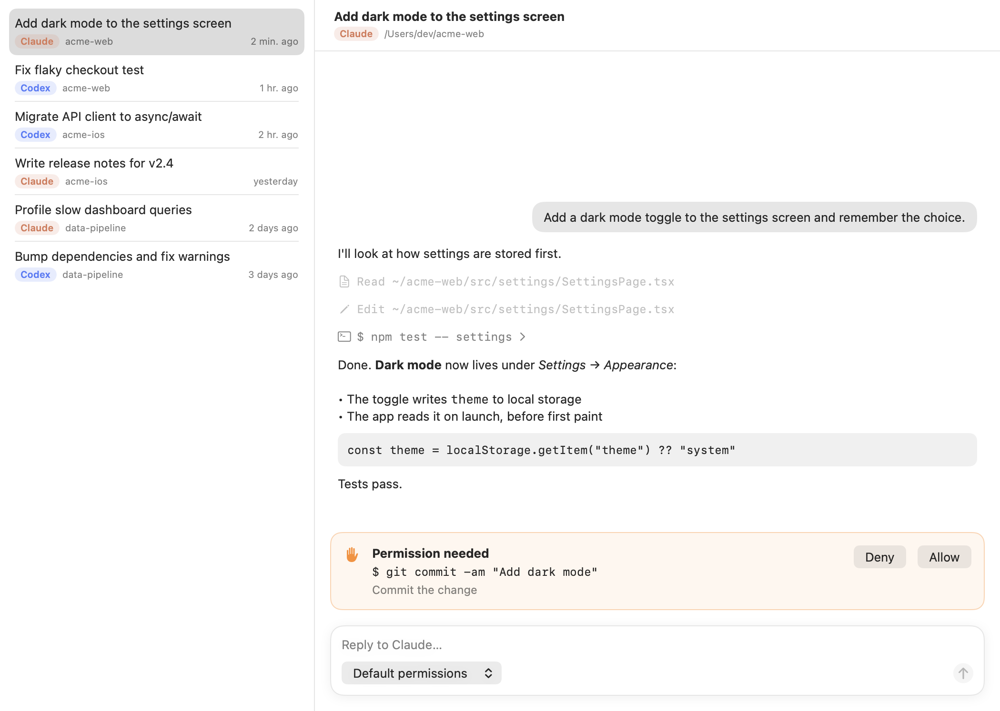

<p align="center"></p>

<h1 align="center">AgentCenter</h1>

<p align="center">All your Claude Code and Codex sessions in one native Mac app.</p>

AgentCenter finds every session you've had with **Claude Code** (in the terminal or the Claude app) and **Codex** (the CLI or the ChatGPT/Codex app), groups them by project, and lets you continue any of them, or start a new task with either agent, from one window.



## What it does

- **Every session, one list.** Claude Code and Codex side by side, newest first, grouped by project folder, searchable. Sessions you archived in either app stay hidden.
- **Readable transcripts.** Messages, commands, file edits and their output. Tool calls stay collapsed until you want them.
- **Continue or start tasks.** Reply to any session or start a new one with either agent. Replies stream in live.
- **Approve from the app.** When an agent wants to run a command or edit a file, you get an Allow / Deny card.
- **Jump to the native app.** Open a session in the Claude app or the ChatGPT/Codex app, or resume it in Terminal.
- **Nothing in between.** It drives the official CLIs on your Mac with the logins you already have. No server, no API keys, no telemetry.

## Install

Download `AgentCenter-x.y.z.zip` from [Releases](https://github.com/shiyu-mizusu/AgentCenter/releases), unzip it, and drag **AgentCenter** to Applications.
The build isn't notarized yet, so macOS blocks the first launch. Open **System Settings → Privacy & Security** and click **Open Anyway**, or run:

```bash
xattr -dr com.apple.quarantine /Applications/AgentCenter.app
```

Or build it yourself (Xcode 16 or later):

```bash
git clone https://github.com/shiyu-mizusu/AgentCenter.git && cd AgentCenter && scripts/build-app.sh && open build/AgentCenter.app
```

**Requirements:** macOS 14 or later, plus at least one agent:

- **Claude Code**: the `claude` CLI, or just the Claude desktop app (AgentCenter uses the copy it downloads).
- **Codex**: the ChatGPT (Codex) desktop app, or `npm i -g @openai/codex`.

AgentCenter finds both on your login shell's `PATH`, inside the desktop apps, or wherever you point it in **Settings**.

## Using it

| | |
|---|---|
| New task | **⌘N**, pick Claude or Codex and a folder, describe the task |
| Send / new line | **Return** / **⌥Return** |
| Refresh | **⌘R**. Also refreshes on its own whenever you switch back to the app |
| Permissions | The menu under the message box. **Default permissions** uses your own Claude/Codex settings |
| More | Right-click a session: open in the agent's app, resume in Terminal, show folder, copy ID |

## How it works

| | Claude Code | Codex |
|---|---|---|
| Lists sessions | reads `~/.claude/projects/*/*.jsonl` (head and tail only, so it's fast) | `codex app-server` → `thread/list` |
| Shows a transcript | parses the session's JSONL | `thread/turns/list` |
| Runs a task | `claude -p` with `stream-json` input and output | `thread/start` / `thread/resume` → `turn/start` |
| Asks permission | `--permission-prompt-tool stdio` control requests | `item/*/requestApproval` server requests |
| Opens in its app | `claude://code/continue?session=<id>` | `codex://threads/<id>` |

`codex app-server` is the same JSON-RPC API the Codex app and IDE extensions use, so tasks you start here show up in the Codex app too.

Known limits: the Claude app can only reopen sessions it started itself (others open in Terminal). Very long Claude sessions (hundreds of MB) show their most recent 24 MB.

## Development

The whole app is about 1,600 lines of Swift in `Sources/AgentCenter`, with no dependencies:

| File | What's in it |
|---|---|
| `App.swift` | App, menus, Settings |
| `Model.swift` | Shared types and `AppModel` (state, runs, handoff to the native apps) |
| `Claude.swift` | Claude Code: session index, transcript parser, `claude -p` runner |
| `Codex.swift` | Codex: `app-server` JSON-RPC client, threads, runner |
| `Views.swift` / `Transcript.swift` | The UI |
| `System.swift` | Login-shell environment, JSON-lines I/O, small helpers |

```bash
swift run AgentCenter                                       # run from source
swift test                                                  # parser tests
LIVE=1 swift test --filter LiveTests                        # a real one-line task through each installed CLI (costs a few tokens)
SNAPSHOT_DIR=/tmp/shots swift test --filter SnapshotTests   # render the UI offscreen to PNGs
VERSION=1.0.0 scripts/build-app.sh --zip                    # universal .app and zip in build/
```

Pushing a `v*` tag builds the app and attaches the zip to a GitHub release (see `.github/workflows/ci.yml`).
Pull requests are welcome. Please keep it small and simple.

## License

MIT
