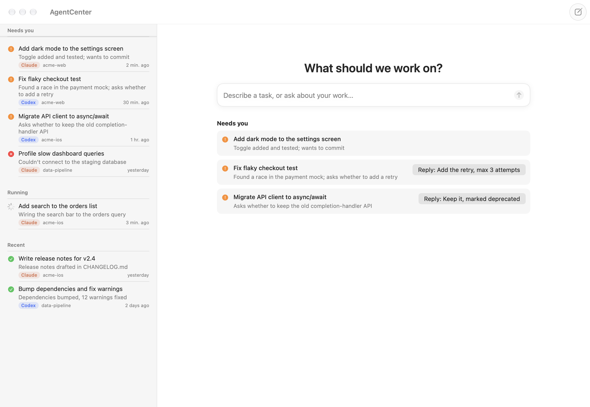
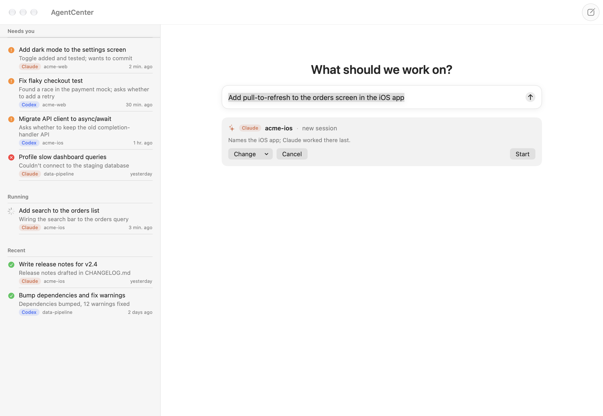
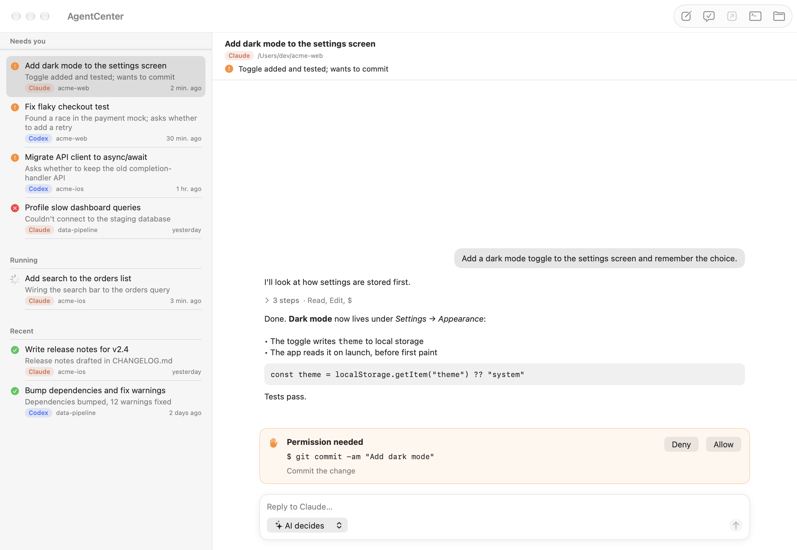

<p align="center"></p>

<h1 align="center">AgentCenter</h1>

<p align="center">An AI-first home for your coding agents. Say what you want; it picks Claude Code or Codex,<br>the project and the session, and keeps track of what needs you.</p>



## What it does

- **One box for everything.** Describe a task or ask about your work. The AI picks the agent, the project, and whether to continue an existing session, then shows you the plan; Return starts it. Ask "what needs me?" and it answers from your sessions.
- **An inbox the AI sorts.** Every Claude Code and Codex session, from the terminal or the desktop apps, lands in **Needs you**, **Running** or **Recent**, each with a one-line status the AI wrote and, when an agent is waiting on you, a suggested reply one click away.
- **AI decides permissions.** By default each agent's own reviewer approves routine actions (Claude's auto mode, Codex's `auto_review`). Only what it escalates reaches you, as an Allow / Deny card. Agents' questions show up as buttons.
- **A second opinion in one click.** Ask the other agent to review the changes, read-only.
- **Everything else in one place.** Readable transcripts (runs of tool calls fold into "14 steps"), continue any session, open it in the Claude or ChatGPT app, or resume it in Terminal.
- **No server, no API keys.** It drives the official CLIs with the logins you already have, and the AI decisions run through those same logins.

| The AI routes a request | Every session, one place |
|---|---|
|  |  |

## Install

Download `AgentCenter-x.y.z.zip` from [Releases](https://github.com/shiyu-mizusu/AgentCenter/releases), unzip it, and drag **AgentCenter** to Applications.
The build isn't notarized yet, so macOS blocks the first launch. Open **System Settings → Privacy & Security** and click **Open Anyway**, or run:

```bash
xattr -dr com.apple.quarantine /Applications/AgentCenter.app
```

Or build it yourself (Xcode 16 or later):

```bash
git clone https://github.com/shiyu-mizusu/AgentCenter.git && cd AgentCenter && scripts/build-app.sh && open build/AgentCenter.app
```

**Requirements:** macOS 14 or later, plus at least one agent:

- **Claude Code**: the `claude` CLI, or just the Claude desktop app (AgentCenter uses the copy it downloads).
- **Codex**: the ChatGPT (Codex) desktop app, or `npm i -g @openai/codex`.

AgentCenter finds both on your login shell's `PATH`, inside the desktop apps, or wherever you point it in **Settings**.

## Using it

| | |
|---|---|
| New task | **⌘N**, type what you want, **Return**. Check the plan, **Return** again to start |
| Reply to a session | Type below the transcript, **Return** (**⌥Return** for a new line) |
| Access | The menu under the message box: **AI decides** (default), **Ask me**, **Read only**, **Full access** |
| Second opinion | **Review with Codex / Claude** in the toolbar |
| Refresh | **⌘R**. It also refreshes whenever you switch back to the app |
| More | Right-click a session: open in the agent's app, resume in Terminal, show folder, copy ID |

## How it works

| | Claude Code | Codex |
|---|---|---|
| Lists sessions | reads `~/.claude/projects/*/*.jsonl` (head and tail only, so it's fast) | `codex app-server` → `thread/list` |
| Shows a transcript | parses the session's JSONL | `thread/turns/list` |
| Runs a task | `claude -p` with `stream-json` input and output | `thread/start` / `thread/resume` → `turn/start` |
| "AI decides" access | `--permission-mode auto` | `approvalsReviewer: "auto_review"`, workspace-write sandbox |
| Asks you | `--permission-prompt-tool stdio`: approvals and `AskUserQuestion` | `requestApproval` and `requestUserInput` server requests |
| Opens in its app | `claude://code/continue?session=<the app's id>` | `codex://threads/<id>` |

**The AI decisions** (routing a request, triaging sessions) are small structured calls: Claude Haiku via `claude -p --safe-mode --tools ""` (no tools, hooks, MCP or CLAUDE.md), or Codex via an isolated, read-only `codex exec` when Claude isn't available. The router can only choose projects and sessions it was shown; anything else waits for you to pick a folder.

**Privacy:** to triage, AgentCenter sends the last request and reply of sessions active in the past three days to Claude or Codex through your own account. Turn it off in **Settings**. Nothing else leaves your Mac except what the agents themselves send.

`codex app-server` is the same JSON-RPC API the Codex app uses, so tasks you start here show up there too.

Known limits: the Claude app can only reopen sessions it started itself (others open in Terminal). Very long Claude sessions (hundreds of MB) show their most recent 24 MB.

## Development

About 2,400 lines of Swift in `Sources/AgentCenter`, no dependencies:

| File | What's in it |
|---|---|
| `App.swift` | App, menus, Settings |
| `Model.swift` | Shared types and `AppModel`: sessions, runs, AI routing and triage, handoff to the native apps |
| `Brain.swift` | The AI decisions: routing prompt and validation, triage, the Claude/Codex structured calls |
| `Claude.swift` | Claude Code: session index, transcript parser, `claude -p` runner |
| `Codex.swift` | Codex: `app-server` JSON-RPC client, threads, runner |
| `Views.swift` / `Transcript.swift` | The UI |
| `System.swift` | Login-shell environment, process runner, JSON-lines I/O |

```bash
swift run AgentCenter                                       # run from source
swift test                                                  # parser and routing tests
LIVE=1 swift test --filter LiveTests                        # real runs, Stop and AI decisions on each installed CLI (costs a few tokens)
SNAPSHOT_DIR=/tmp/shots swift test --filter SnapshotTests   # render the UI offscreen to PNGs
VERSION=1.0.0 scripts/build-app.sh --zip                    # universal .app and zip in build/
```

Pushing a `v*` tag builds the app and attaches the zip to a GitHub release (see `.github/workflows/ci.yml`).
Pull requests are welcome. Please keep it small and simple.

## License

MIT
